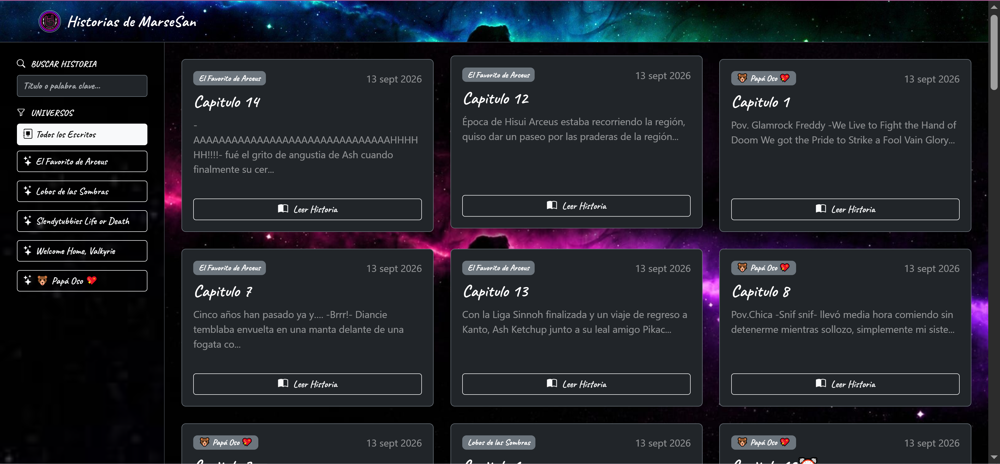
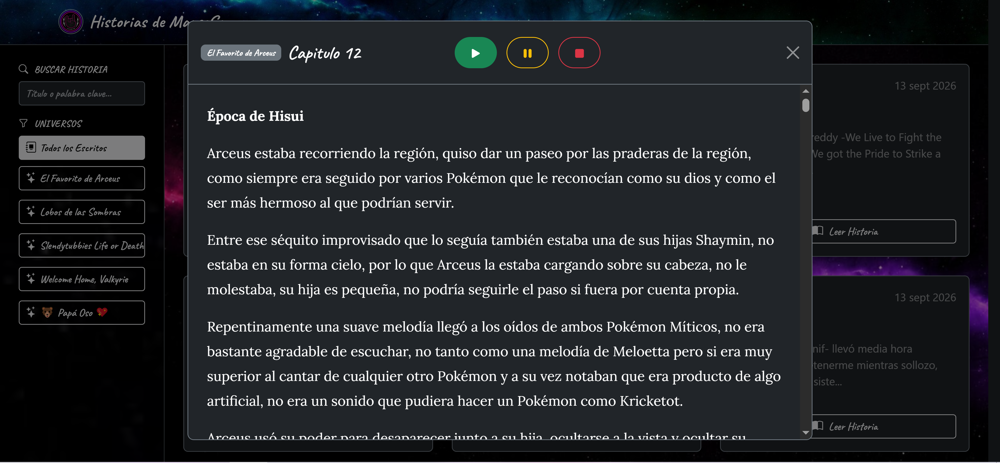
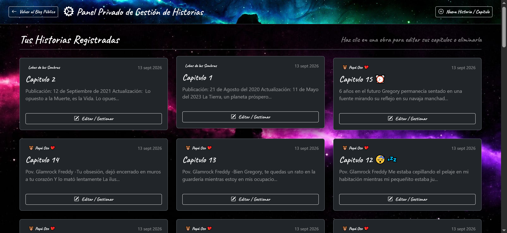
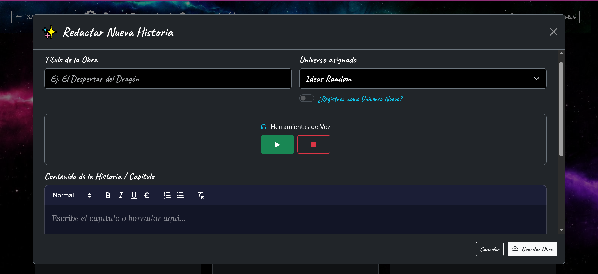

# Historias de MarseSan

Página personal para escribir, guardar y leer mis historias, organizadas por universo, con editor de texto enriquecido, texto a voz y almacenamiento en Firebase. Nació como reemplazo de Word y Google Docs para mis borradores.

🔗 [Ver proyecto en vivo](https://danisasantillan.github.io/historias-marsesan/)
📂 [Ver código fuente](https://github.com/DanIsaSantillan/historias-marsesan)

## Capturas

## Por qué existe este proyecto

Escribo historias como pasatiempo, y mis borradores vivían en Word y Google Docs. En Google Docs me topé varias veces con que el almacenamiento de la nube se llenaba y escribir o editar se volvía imposible sin espacio libre. Al liberar espacio terminé perdiendo documentos originales junto con las copias de seguridad, y con ellos horas de trabajo creativo. Quería un lugar propio donde escribir, guardar y leer mis historias sin depender de los límites de almacenamiento de otros servicios.

## Funcionalidades

**Lectura (pública):**
- Tarjetas por historia con título, universo, fecha de publicación y un fragmento del texto.
- Filtro por **universo** (la saga o serie a la que pertenece cada historia) y búsqueda por título o palabra clave.
- Modal de lectura para leer cada historia completa. En el celular, el botón "atrás" cierra el modal en lugar de salir de la página.
- **Texto a voz** con reproducir, pausa, reanudar y detener, para escuchar la historia mientras se hace otra actividad.
- Diseño adaptable a escritorio y celular, e instalable como app en el teléfono.

**Escritura (modo administrador):**
- Acceso oculto: un triple clic en la imagen de perfil lleva al panel, que pide iniciar sesión con correo y contraseña (Firebase Authentication).
- Panel para crear, editar y eliminar historias.
- Modal de escritura con **Quill** como editor de texto: título, universo asignado (existente o nuevo) y formato de texto (encabezados, negritas, cursiva, subrayado, tachado y listas).
- Texto a voz (**Leer** y **Detener**) para escuchar la selección o el borrador completo y revisar lo escrito.
- Botón **Guardar Obra**, que guarda la historia en Firestore.

## Stack técnico

- HTML, CSS, JavaScript (módulos ES) y Bootstrap
- **Firebase Firestore** como base de datos (colecciones `historias` y `universos`)
- **Firebase Authentication** (correo y contraseña) para el acceso al panel
- **Quill** como editor de texto enriquecido
- Texto a voz del navegador (Web Speech API)
- **`manifest.json`** para instalar la página como app en el celular
- Publicación en GitHub Pages, con Git por terminal para subir los cambios

JavaScript lee las historias desde Firestore, genera automáticamente las tarjetas, las agrupa por universo y construye el modal de lectura. El JavaScript del panel de administrador verifica la sesión, abre el modal de escritura y guarda, edita o elimina las historias en Firestore.

## Decisiones técnicas

**Reutilizar la estructura de la galería:** mantuve la estética y el funcionamiento de mi proyecto Galería de MarseSan, porque las funciones eran muy parecidas: uno muestra y guarda ilustraciones y este muestra y guarda textos. Reutilizar el diseño ahorró tiempo y me permitió concentrarme en lo nuevo.

**Firestore como eje del proyecto:** al ser una base de datos NoSQL organizada en colecciones y documentos, no exige diseñar tablas ni un esquema rígido de antemano, lo que encaja bien con textos de longitud y formato variables. También reduce el riesgo de romper el proyecto al agregar historias nuevas, que era una preocupación real con una base de datos manual.

**Descartar JSON como base de datos:** en mis proyectos anteriores usé un archivo JSON para guardar datos, pero aquí vi que sería poco eficiente y que acabaría siendo un lastre, así que lo descarté desde el principio.

**Publicar en GitHub desde el inicio:** subí el proyecto desde el comienzo para conectar Firebase de inmediato y poder pulir las funciones teniendo una base de datos activa.

**Quill como editor:** es una herramienta externa que ya incluía todas las herramientas de formato que necesitaba, y la integré dentro de un modal exclusivo del modo administrador.

**Texto a voz en lectura y escritura:** lo agregué en ambos modos para poder revisar un texto mientras lo escribo, o escucharlo días después mientras hago otra actividad.

**Autenticación y reglas de seguridad:** el acceso al panel usa Firebase Authentication con una cuenta única. Pero iniciar sesión solo protege la interfaz; lo que protege los datos son las **reglas de Firestore**, que permiten leer a cualquiera (el blog es público) y escribir únicamente a mi usuario.

## Retos que resolví

- **Conectar Firebase desde una etapa temprana:** en mis proyectos anteriores Firebase solo servía para los comentarios, y se agregaba al final. Aquí es la base de todo, así que tenía que funcionar desde el inicio. Como las actualizaciones de la página tardaban en reflejarse, era difícil saber si Firebase estaba bien conectado o si el problema era otro.
- **Proteger el panel de administrador de verdad:** la primera versión validaba un token de GitHub en el navegador. Revisando el código descubrí que eso solo protegía la interfaz: aceptaba cualquier token válido de GitHub, y las reglas de Firestore permitían escribir a cualquiera. Lo reemplacé por Firebase Authentication y cerré las reglas para que solo mi usuario pueda escribir. Además, la sesión se mantiene iniciada, así que ya no tengo que generar un token nuevo cada mes.
- **Botón "atrás" en el celular:** al abrir una historia y presionar "atrás", la página se cerraba por completo en lugar de cerrar solo el modal. Lo resolví con `history.pushState` y el evento `popstate`, para que el botón "atrás" cierre el modal.
- **Usar Git por terminal:** en los proyectos anteriores subía todo manualmente a GitHub, algo lento para un proyecto que iba cambiando seguido. Retomé los comandos de terminal (`git add`, `git commit`, `git push`). Al combinar subidas manuales con la terminal, el repositorio se desincronizó y GitHub rechazó un `push`; lo resolví con `git pull` antes de volver a subir.
- **Función de texto a voz:** nunca la había usado, y empezó como un capricho. Acomodarla de forma eficiente tanto en escritorio como en celular, incluyendo la pausa y reanudación, tuvo sus complicaciones.
- **Instalar la página como app:** copié el `manifest.json` de la galería esperando que funcionara igual, pero no funcionó. Probé distintos ajustes por prueba y error hasta que se instaló como acceso directo en mi teléfono.

## Limitaciones conocidas

- El panel de administrador está pensado para una sola persona, con una única cuenta.
- Las historias publicadas pueden leerse por cualquiera que tenga el link.
- El proyecto depende de Firebase, un servicio externo, para guardar todos los textos.
- El contenido de las historias se inserta como HTML en la página. Es seguro mientras solo yo pueda escribir, pero si algún día se aceptaran textos de otras personas, habría que sanitizarlos.
- Los nombres y palabras inventadas aparecen subrayadas por el corrector del navegador, y JavaScript no puede personalizar ese diccionario.
