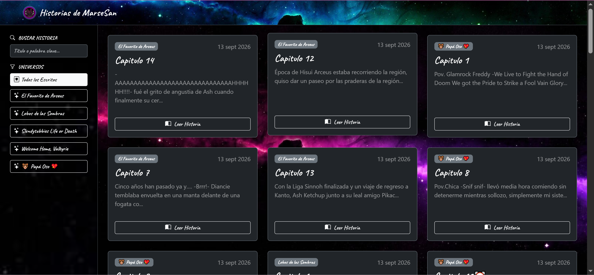
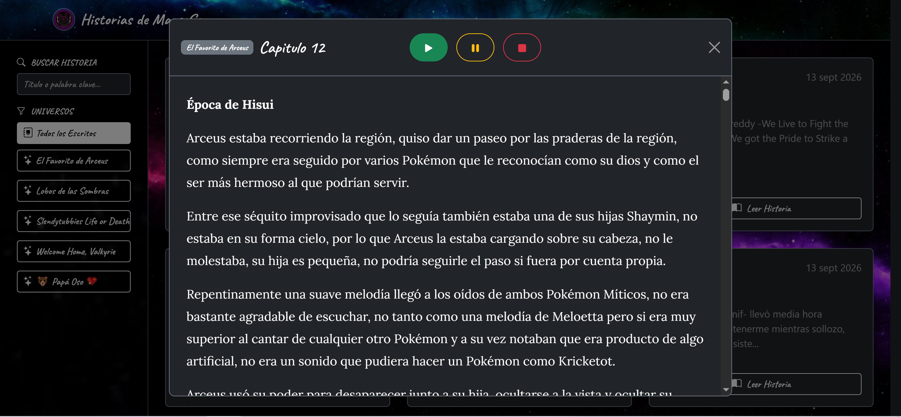
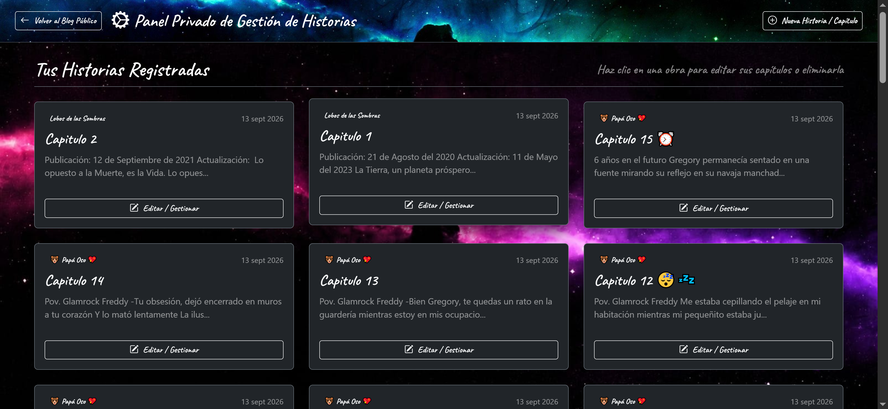
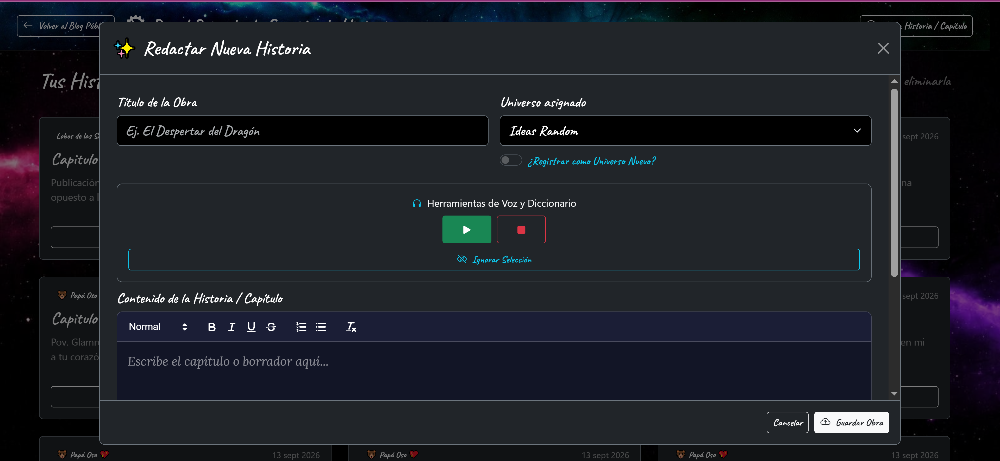

# Historias de MarseSan

Página personal para escribir, guardar y leer mis historias, organizadas por universo, con editor de texto enriquecido, texto a voz y almacenamiento en Firebase. Nació como reemplazo de Word y Google Docs para mis borradores.

🔗 [Ver proyecto en vivo](https://danisasantillan.github.io/historias-marsesan/)
📂 [Ver código fuente](https://github.com/DanIsaSantillan/historias-marsesan)

## Capturas

## Por qué existe este proyecto

Escribo historias como pasatiempo, y mis borradores vivían en Word y Google Docs. En Google Docs me topé varias veces con que el almacenamiento de la nube se llenaba y escribir o editar se volvía imposible sin espacio libre. Al liberar espacio terminé perdiendo documentos originales junto con las copias de seguridad, y con ellos horas de trabajo creativo. Quería un lugar propio donde escribir, guardar y leer mis historias sin depender de los límites de almacenamiento de otros servicios.

## Funcionalidades

**Lectura (pública):**
- Tarjetas por historia con título, universo, fecha de publicación y un fragmento del texto.
- Filtro por **universo** (la saga o serie a la que pertenece cada historia) y búsqueda por título o palabra clave.
- Modal de lectura para leer cada historia completa.
- **Texto a voz** para escuchar la historia mientras se hace otra actividad.
- Diseño adaptable a escritorio y celular, e instalable como app en el teléfono.

**Escritura (modo administrador):**
- Acceso oculto mediante triple clic en la imagen de perfil, más un token válido.
- Modal de escritura con **Quill** como editor de texto: título, universo asignado (existente o nuevo), y formato de texto (negritas, cursiva, subrayado, tachado y listas).
- Botones de texto a voz (**Leer** y **Detener**) para escuchar lo escrito y revisarlo.
- **Ignorar selección:** funciona como un diccionario personalizado. Al marcar una palabra inventada que sí forma parte de la historia (por ejemplo, el nombre de un personaje o un lugar), el corrector deja de señalarla como error y solo resalta las fallas reales.
- Botón **Guardar Obra**, que guarda la historia en Firebase.

## Stack técnico

- HTML, Bootstrap, CSS y JavaScript
- **Firebase** como base de datos de las historias
- **Quill** como editor de texto enriquecido
- Texto a voz del navegador
- **`manifest.json`** para instalar la página como app en el celular
- Publicación en GitHub Pages, con Git por terminal para subir los cambios

JavaScript lee las historias desde Firebase, genera automáticamente las tarjetas, las agrupa por universo y construye el modal de lectura. El JavaScript del modo administrador abre el modal de escritura y guarda el texto en Firebase.

## Decisiones técnicas

**Reutilizar la estructura de la galería:** mantuve la estética y el funcionamiento de mi proyecto Galería de MarseSan, porque las funciones eran muy parecidas: uno muestra y guarda ilustraciones y este muestra y guarda textos. Reutilizar el diseño ahorró tiempo y me permitió concentrarme en lo nuevo.

**Firebase como eje del proyecto:** al ser una base de datos NoSQL, no exige diseñar tablas ni un esquema rígido de antemano, lo que encaja bien con textos de longitud y formato variables. También reduce el riesgo de romper el proyecto al agregar historias nuevas, que era una preocupación real con una base de datos manual.

**Descartar JSON como base de datos:** en mis proyectos anteriores usé un archivo JSON para guardar datos, pero aquí vi que sería poco eficiente y que acabaría siendo un lastre, así que lo descarté desde el principio.

**Publicar en GitHub desde el inicio:** subí el proyecto desde el comienzo para conectar Firebase de inmediato y poder pulir las funciones teniendo una base de datos activa.

**Quill como editor:** es una herramienta externa que ya incluía todas las herramientas de formato que necesitaba, y la integré dentro de un modal exclusivo del modo administrador.

**Texto a voz en lectura y escritura:** lo agregué en ambos modos para poder revisar un texto mientras lo escribo, o escucharlo días después mientras hago otra actividad.

**Acceso protegido al modo administrador:** el modal de escritura y edición solo se abre con triple clic sobre la imagen de perfil y un token válido. Sin token, el acceso se niega.

## Retos que resolví

- **Conectar Firebase desde una etapa temprana:** en mis proyectos anteriores Firebase solo servía para los comentarios, y se agregaba al final. Aquí es la base de todo, así que tenía que funcionar desde el inicio. Como las actualizaciones de la página tardaban en reflejarse, era difícil saber si Firebase estaba bien conectado o si el problema era otro.
- **Usar Git por terminal:** en los proyectos anteriores subía todo manualmente a GitHub, algo lento para un proyecto que iba cambiando seguido. Retomé los comandos de terminal (`git add`, `git commit`, `git push`) para actualizar la página con rapidez.
- **Función de texto a voz:** nunca la había usado, y empezó como un capricho. Acomodarla de forma eficiente tanto en escritorio como en celular tuvo sus complicaciones.
- **Instalar la página como app:** copié el manifest.json de la galería esperando que funcionara igual, pero no funcionó. Probé distintos ajustes por prueba y error hasta que se instaló como acceso directo en mi teléfono.

## Limitaciones conocidas

- El modo administrador está pensado para una sola persona, sin cuentas de usuario.
- Las historias publicadas pueden leerse por cualquiera que tenga el link.
- El proyecto depende de Firebase, un servicio externo, para guardar todos los textos.
